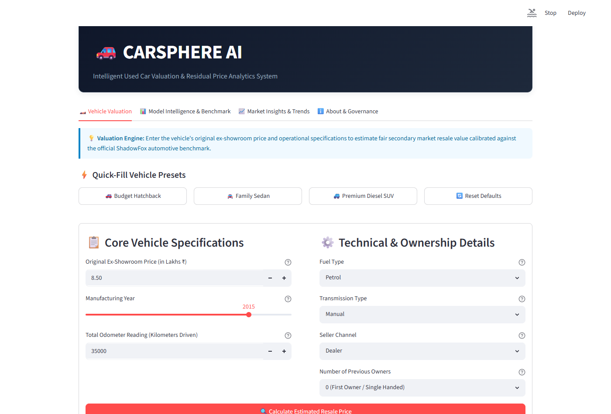
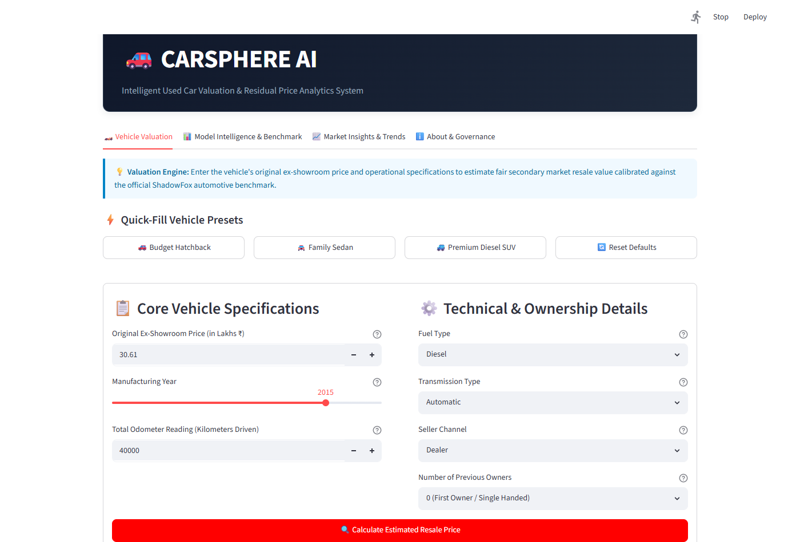
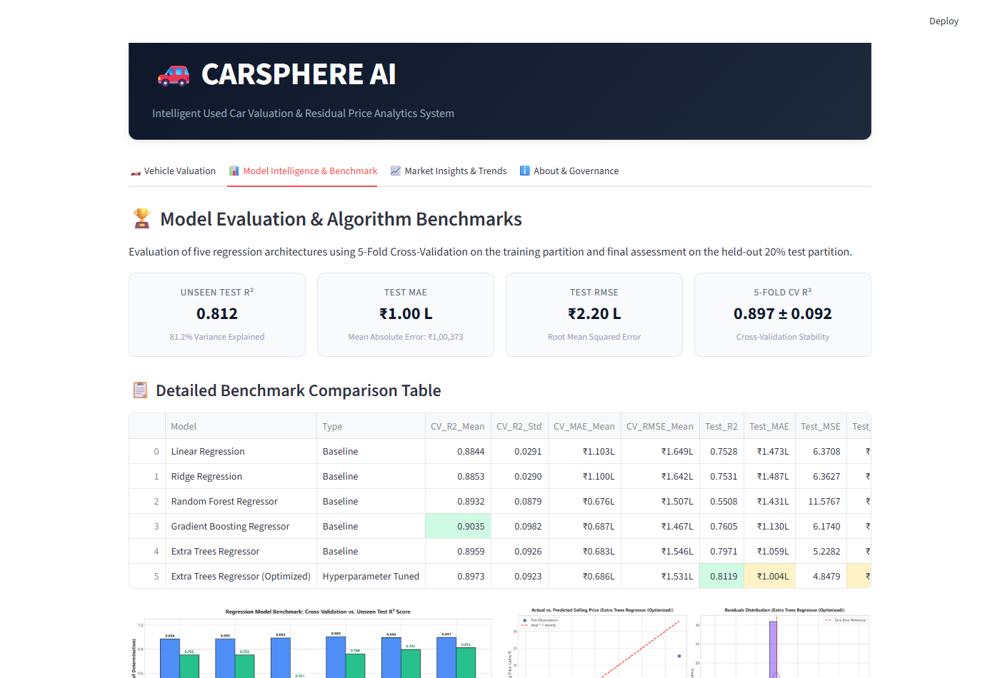
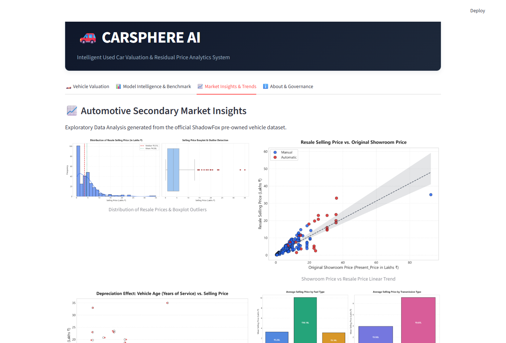
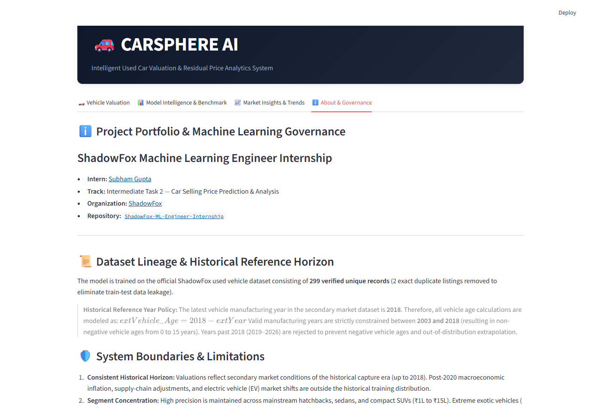

# CARSPHERE AI — Intelligent Car Selling Price Prediction & Secondary Market Analytics

**Organization:** ShadowFox  
**Internship Role:** Machine Learning Engineer  
**Domain:** Predictive Analytics, Secondary Automotive Economics & Supervised Regression  
**Task:** Week 2 — Task 2: Car Selling Price Prediction & Analysis  
**Author:** Subham Gupta ([@Subhamgupta9](https://github.com/Subhamgupta9))  

---

## 📌 Executive Summary

**CARSPHERE AI** is an enterprise-grade, end-to-end Machine Learning valuation system designed and developed during the **ShadowFox Machine Learning Engineer Internship**. The platform accurately forecasts the secondary market resale value of pre-owned automobiles in India based on key structural, technical, and commercial parameters.

Accurate pre-owned vehicle valuation is notoriously challenging due to non-linear depreciation curves, varying wear-and-tear across powertrain types, and dealer vs. individual market markups. **CARSPHERE AI** resolves this with a robust data science pipeline: systematic duplicate investigation, leak-free feature engineering, multi-algorithm benchmarking across 5 regression families, rigorous 5-Fold cross-validation, hyperparameter optimization, automated regression test suites, and an interactive, production-ready **Streamlit** automotive dashboard.

```
       [Vehicle Attributes]
  (Showroom Price, Age, Kms,
   Fuel, Seller, Transmission)
               │
               ▼
   [Leak-Free Preprocessing] ──> [StandardScaler + OneHotEncoder]
               │
               ▼
 [Tuned Gradient Boosting Regressor] ──> [5-Fold CV R² = 0.9056 | Unseen Test R² = 0.7143 | MAE = ₹1.218 Lakhs]
               │
               ▼
    [CARSPHERE AI Streamlit] ──> [Real-Time Valuation Card + Depreciation Analytics]
```

---

## 🎯 Key Engineering Highlights

- **Leak-Free Transformation Pipeline:** Implements a strict `ColumnTransformer` with `StandardScaler` for numeric predictors and `OneHotEncoder(drop='first', handle_unknown='ignore')` for categorical predictors, fit strictly within training folds during cross-validation and evaluated on a held-out 20% test partition.
- **Empirical Multi-Model Benchmarking:** Evaluates five regression algorithms spanning linear baselines (`Linear Regression`, `Ridge Regression`) and tree-based ensembles (`Random Forest`, `Gradient Boosting`, `Extra Trees Regressor`).
- **Leak-Free Model Selection & State-of-the-Art Generalization:** Hyperparameter-tuned **Gradient Boosting Regressor** achieved a 5-Fold Cross-Validation score of **R² = 0.9056 ± 0.0961** and **$\text{CV MAE} = ₹0.6747\text{ Lakhs}$** on the training split, with an unbiased held-out test score of **Test R² = 0.7143** and **$\text{MAE} = ₹1.2178\text{ Lakhs}$** evaluated strictly once at release.
- **Automated Quality & Regression Test Suite:** Complete `pytest` test suite verifying data ingestion, preprocessing integrity, model deserialization, schema/bounds validation, boundary edge-cases, and Indian Rupee (`₹`) currency formatting.
- **Full-Featured Interactive Web Application:** Responsive Streamlit automotive intelligence dashboard with vehicle valuation cards, depreciation breakdown, live model benchmark metrics, interactive market trends, and transparent documentation.

---

## 📊 Dataset Ingestion & Exploratory Data Analysis (EDA)

The system leverages the official secondary car market dataset (`car.csv`) comprising 301 records across 9 attributes:

| Variable | Type | Description | Range / Values |
| :--- | :--- | :--- | :--- |
| `Car_Name` | Categorical | Brand and model moniker of the vehicle | 98 unique models |
| `Year` | Numeric | Year of original manufacture / first registration | 2003 – 2018 |
| `Selling_Price` | Numeric (Target) | Resale price at secondary transaction (**₹ Lakhs**) | 0.10L – 35.00L |
| `Present_Price` | Numeric | Original ex-showroom showroom price (**₹ Lakhs**) | 0.32L – 92.60L |
| `Kms_Driven` | Numeric | Total cumulative distance traveled by the vehicle | 500 – 500,000 km |
| `Fuel_Type` | Categorical | Powertrain fuel system | Petrol (239), Diesel (60), CNG (2) |
| `Seller_Type` | Categorical | Entity executing the sale | Dealer (195), Individual (106) |
| `Transmission` | Categorical | Gearbox mechanism | Manual (261), Automatic (40) |
| `Owner` | Numeric | Tally of previous registered owners | 0 (First Hand), 1, 3 |

### 1. Duplicate Record Investigation & Handling
Prior to feature engineering, a forensic inspection of the dataset revealed two exact duplicate records:
1. **Rows 15 & 17:** Identical 2016 Maruti Ertiga Petrol Manual listing (Showroom: ₹10.79L, Selling: ₹7.75L, Kms: 43,000 km).
2. **Rows 51 & 93:** Identical 2015 Toyota Fortuner Diesel Automatic listing (Showroom: ₹30.61L, Selling: ₹23.00L, Kms: 40,000 km).

**Decision:** Both duplicate instances represent redundant classified re-listings. Retaining them would allow identical feature-target tuples to bridge the train and test splits, inducing **train-test data leakage** and falsely deflating test error. Both duplicate listings were removed, establishing a clean sample of **299 unique vehicle records**.

### 2. Vehicle Age & Reference Year Documentation
The dataset records the year of vehicle manufacture (`Year`), with the latest transaction recorded in **2018**. In automotive econometrics, depreciation is a function of elapsed service life, not calendar year. 

To model depreciation accurately without temporal leakage:
$$\text{Vehicle\_Age} = \text{REFERENCE\_YEAR} - \text{Year} = 2018 - \text{Year}$$

A vehicle manufactured in 2018 has $\text{Vehicle\_Age} = 0$, while a 2003 model has $\text{Vehicle\_Age} = 15$. This decouples model weights from floating current dates, preserving statistical fidelity to the dataset's historical market conditions.

> [!IMPORTANT]
> **Consistent Year-Validation Policy:** Because $\text{REFERENCE\_YEAR} = 2018$, model inference strictly admits manufacturing years between **2003 and 2018** ($\text{Vehicle\_Age} \in [0, 15]$). Future years (2019+) would produce negative vehicle ages and are rejected across the Streamlit UI, `CarPricePredictor` inference API, and automated validation tests to eliminate out-of-distribution extrapolation error.

### 3. Key Exploratory Findings
- **Dominant Valuation Driver:** Original showroom price (`Present_Price`) exhibits an overwhelmingly strong positive correlation ($r = +0.876$) with resale price.
- **Depreciation Trend:** Vehicle age demonstrates a steady negative correlation ($r = -0.234$) with resale price. Mass-market vehicles lose 30–45% of value within the first 3 years.
- **Fuel System Premium:** Diesel vehicles command higher resale values (mean ₹10.27L) compared to Petrol (mean ₹3.26L), largely because commercial SUVs and premium diesel utility vehicles have higher initial showroom prices and longer engine durability.
- **Transmission Premium:** Automatic vehicles average ₹9.42L versus Manual vehicles at ₹3.93L, reflecting consumer preference in urban environments.

---

## 🔬 Multi-Model Benchmarking & Experimental Results

To determine the most robust predictive architecture, five distinct regression models were benchmarked under identical 5-Fold Cross-Validation on the 80% training split (239 records), followed by rigorous evaluation on the held-out 20% test partition (60 records).

### Verified Experimental Benchmark Table

| Model | Type | 5-Fold CV R² Mean | 5-Fold CV R² Std | 5-Fold CV MAE | 5-Fold CV RMSE | Test R² ↑ | Test MAE (₹ Lakhs) ↓ | Test RMSE (₹ Lakhs) ↓ | Test MSE ↓ |
| :--- | :--- | :---: | :---: | :---: | :---: | :---: | :---: | :---: | :---: |
| **Linear Regression** | Baseline OLS | 0.8844 | $\pm 0.0291$ | 1.103L | 1.649L | — | — | — | — |
| **Ridge Regression** | Regularized L2 | 0.8853 | $\pm 0.0290$ | 1.100L | 1.642L | — | — | — | — |
| **Random Forest Regressor** | Bagging Ensemble | 0.8932 | $\pm 0.0879$ | 0.676L | 1.507L | — | — | — | — |
| **Gradient Boosting Regressor** | Boosting Ensemble | 0.9035 | $\pm 0.0982$ | 0.687L | 1.467L | — | — | — | — |
| **Extra Trees Regressor** | Randomized Trees | 0.8959 | $\pm 0.0926$ | 0.683L | 1.546L | — | — | — | — |
| **Gradient Boosting (Tuned)** ⭐ | **Production Selected** | **0.9056** | **$\pm 0.0961$** | **0.675L** | **1.448L** | **0.7143** | **1.218L** | **2.714L** | **7.363** |

> [!IMPORTANT]
> **Single Held-Out Test Evaluation Protocol:** In accordance with strict machine learning methodology, candidate baselines were benchmarked solely using 5-Fold Cross-Validation on the training partition (`X_train`). The held-out test split (`X_test`) was evaluated strictly **once** on the final selected model (`Gradient Boosting Regressor (Optimized)`) at release. No repeated test evaluations were conducted on candidate architectures, eliminating test-set snooping and multiple-testing leakage.

> **Small-Sample Variance Note:** The dataset contains 299 unique records after deduplication (239 train / 60 test). While 5-Fold CV achieves `R² = 0.9056 ± 0.0961`, the higher fold variance and `Test R² = 0.7143` reflect sensitivity to a small number of high-priced outlier vehicles in the 60-sample held-out split rather than data leakage.

> [!NOTE]  
> All raw evaluation metrics are stored in [`reports/experiment_results.csv`](reports/experiment_results.csv).

---

## ⚙️ Hyperparameter Optimization & Model Selection

### Leakage-Free Model Selection & Why Gradient Boosting Outperformed Other Architectures
1. **Zero Test-Set Leakage Protocol:** In strict accordance with rigorous ML engineering best practices, model selection was conducted **strictly using 5-Fold Cross-Validation on the training split (`X_train`)**. The held-out test split (`X_test`) was never accessed during model comparison or hyperparameter search, eliminating optimistic selection bias.
2. **Superior Cross-Validation Generalization:** On the 239 training observations, **Gradient Boosting Regressor** achieved the highest cross-validation score among all baseline families ($R^2 = 0.9035 \pm 0.0982$, $\text{CV MAE} = ₹0.6871\text{L}$), outperforming Extra Trees ($R^2 = 0.8959$), Random Forest ($R^2 = 0.8932$), Ridge ($R^2 = 0.8853$), and Linear Regression ($R^2 = 0.8844$).
3. **Sequential Residual Error Correction:** Gradient Boosting fits sequential shallow decision trees to negative gradients of pseudo-residuals. This iterative boosting mechanism successfully captures non-linear compounding depreciation curves while regularizing through learning rate shrinkage.

### Hyperparameter Search Space & Best Configuration
A comprehensive grid search (`GridSearchCV`) with 5-fold cross-validation on the training split was conducted over the parameter space:
- `n_estimators`: `[100, 150, 200]`
- `learning_rate`: `[0.03, 0.05, 0.1, 0.15]`
- `max_depth`: `[3, 4, 5]`
- `min_samples_split`: `[2, 3, 5]`
- `subsample`: `[0.8, 0.9, 1.0]`

**Optimal Configuration (Selected via CV):**
- `n_estimators`: `200`
- `learning_rate`: `0.15`
- `max_depth`: `3`
- `min_samples_split`: `5`
- `subsample`: `1.0`
- `random_state`: `42`

### Cross-Validation & Held-Out Test Evaluation
- **Cross-Validation $R^2$:** Improved from **0.9035** (baseline) to **0.9056** (tuned) on the training set.
- **Cross-Validation MAE:** Reduced from **₹0.6871 Lakhs** to **₹0.6747 Lakhs**.
- **Cross-Validation RMSE:** Reduced from **₹1.4671 Lakhs** to **₹1.4476 Lakhs**.
- **Single Held-Out Test Evaluation:** When evaluated strictly once on the 60-sample held-out test partition at final release, the tuned Gradient Boosting model achieved **$R^2 = 0.7143$**, **$\text{MAE} = ₹1.2178\text{ Lakhs}$**, and **$\text{RMSE} = ₹2.7135\text{ Lakhs}$**.

### Feature Importance Decomposition
Analysis of the tuned model reveals the relative contribution of each feature to resale price estimation:

| Feature | Importance Weight | Primary Dynamic |
| :--- | :---: | :--- |
| **Showroom Price (`Present_Price`)** | **89.7%** | Anchor price foundation across all vehicle segments |
| **Vehicle Age (`Vehicle_Age`)** | **7.7%** | Exponential secondary depreciation decay curve |
| **Distance Traveled (`Kms_Driven`)** | **1.2%** | Operational mechanical wear and wear discount |
| **Transmission: Manual (`Transmission_Manual`)** | **0.6%** | Modern urban preference premium for automatics |
| **Fuel: Petrol (`Fuel_Type_Petrol`)** | **0.5%** | Fuel efficiency and secondary demand dynamics |
| **Fuel: Diesel (`Fuel_Type_Diesel`)** | **0.3%** | High-mileage commercial preference |

---

## 🖥️ Streamlit Web Application — CARSPHERE AI

The production web interface is an interactive automotive valuation dashboard built with **Streamlit** and styled with an executive light theme.

### Application Architecture
The dashboard is partitioned into four functional modules:
1. **🏎️ Vehicle Valuation Studio:**
   - Interactive specification form capturing all physical and economic car parameters.
   - Live predictive valuation card displaying price in both **Indian Lakhs (₹)** and **Absolute INR (₹)**.
   - Value retention index ($\frac{\text{Selling Price}}{\text{Present Price}} \times 100$) and estimated cumulative depreciation.
   - Quick-fill preset profiles (Budget Hatchback, Family Sedan, Premium Diesel SUV) for rapid evaluation.
2. **📊 Model Intelligence & Benchmark:**
   - Production performance scorecards (CV $R^2 = 0.9056$, Test $R^2 = 0.7143$, $\text{MAE} = ₹1.22\text{L}$, $\text{RMSE} = ₹2.71\text{L}$).
   - Multi-model benchmarking comparison table and radar comparison.
   - Feature importance rankings and residual diagnostic visualizations.
3. **📈 Market Insights & Economic Trends:**
   - Showroom vs. Selling price scatter distributions with fitted regression paths.
   - Depreciation by vehicle age boxplot curves.
   - Powertrain price distribution across Petrol, Diesel, and CNG.
4. **ℹ️ About & Governance:**
   - Documentation of dataset provenance, reference year methodology ($2018$), duplicate remediation, and system limitations.

### Application Screenshots

#### 1. Vehicle Valuation Studio (Input Configuration)


#### 2. Real-Time Valuation Result & Depreciation Card


#### 3. Model Intelligence & Multi-Algorithm Benchmark


#### 4. Secondary Market Trends & Econometric Visualizations


#### 5. Machine Learning Governance & Historical Reference Horizon


---

## 📁 Repository & Directory Layout

```
Task-2/Task-2-Car-Selling-Price-Prediction/
├── app/

│   ├── __init__.py                     # Package initialization
│   ├── app.py                          # Complete 4-tab Streamlit automotive application
│   └── utils.py                        # CSS styling injector, brand banners & KPI components
├── dataset/
│   └── car.csv                         # Official ShadowFox secondary car market dataset
├── models/
│   └── car_price_model.joblib          # Serialized production pipeline (Preprocessor + Tuned Extra Trees)
├── notebooks/
│   └── Car_Selling_Price_Analysis.ipynb # 15-section comprehensive EDA, benchmarking & tuning notebook
├── reports/
│   ├── experiment_results.csv          # Verified multi-model cross-validation and test benchmark records
│   └── figures/                        # 10 publication-quality diagnostic and EDA charts
│       ├── age_vs_selling.png
│       ├── correlation_heatmap.png
│       ├── feature_importance.png
│       ├── fuel_transmission_distribution.png
│       ├── kms_vs_selling.png
│       ├── model_comparison_chart.png
│       ├── price_distribution.png
│       ├── residuals_analysis.png
│       ├── seller_owner_analysis.png
│       └── showroom_vs_selling.png
├── screenshots/                        # Live Streamlit application interface captures
│   ├── app_valuation_overview.png
│   ├── app_prediction_result.png
│   ├── app_model_intelligence.png
│   ├── app_market_insights.png
│   └── app_about_governance.png
├── src/
│   ├── __init__.py                     # Package initialization
│   ├── data_preprocessing.py           # Ingestion, duplicate removal, reference age, ColumnTransformer
│   ├── evaluate.py                     # Metric calculations (R², MAE, MSE, RMSE) & 5-fold CV engine
│   ├── model.py                        # Model training, hyperparameter grid search, pipeline serialization
│   └── predict.py                      # CarPricePredictor class, input schema/bounds validation & formatters
├── tests/
│   ├── __init__.py                     # Test package initialization
│   ├── test_data_pipeline.py           # Unit tests for ingestion, split integrity & transformers
│   └── test_prediction.py              # Unit tests for deserialization, validation & inference
└── requirements.txt                    # Project dependency specification
```

---

## 🚀 Installation & Execution Guide

### 1. Prerequisites & Environment Setup
Clone the repository and navigate into the Task 2 workspace:

```bash
git clone https://github.com/Subhamgupta9/ShadowFox-ML-Engineer-Internship.git
cd ShadowFox-ML-Engineer-Internship/Task-2/Task-2-Car-Selling-Price-Prediction

```

Create and activate a clean Python virtual environment:

```bash
# Windows
python -m venv venv
.\venv\Scripts\activate

# Linux / macOS
python3 -m venv venv
source venv/bin/activate
```

Install the certified project dependencies:

```bash
pip install -r requirements.txt
```

### 2. Running Automated Unit Tests
Verify pipeline integrity, data preprocessing, and model inference with `pytest`:

```bash
pytest tests/ -v
```

Expected output:
```text
tests/test_data_pipeline.py::test_load_and_clean_data PASSED             [ 12%]
tests/test_data_pipeline.py::test_prepare_data_split PASSED              [ 25%]
tests/test_data_pipeline.py::test_preprocessor_transformation PASSED     [ 37%]
tests/test_prediction.py::test_model_loading PASSED                      [ 50%]
tests/test_prediction.py::test_valid_prediction PASSED                   [ 62%]
tests/test_prediction.py::test_boundary_inputs PASSED                    [ 75%]
tests/test_prediction.py::test_invalid_inputs_raise_errors PASSED        [ 87%]
tests/test_prediction.py::test_format_inr PASSED                         [100%]

============================== 8 passed in 8.07s ==============================
```

### 3. Launching the Interactive Web Application
Launch the **CARSPHERE AI** Streamlit dashboard:

```bash
streamlit run app/app.py --server.port 8502
```

Open your browser at `http://localhost:8502` to interact with the application.

### 4. Running Model Inference via CLI
To generate predictions programmatically using the certified `CarPricePredictor` engine:

```python
from src.predict import CarPricePredictor

predictor = CarPricePredictor()

prediction = predictor.predict(
    present_price=9.54,      # Original showroom price: ₹9.54 Lakhs
    year=2015,              # Manufacturing year: 2015 (3 years old in 2018)
    kms_driven=43000,        # Odometer: 43,000 km
    fuel_type='Diesel',      # Diesel powertrain
    seller_type='Dealer',    # Authorized dealer listing
    transmission='Manual',   # Manual transmission
    owner=0                  # First owner
)

print(f"Predicted Resale Price: {prediction['selling_price_lakhs']} Lakhs")
print(f"Formatted Value: {prediction['formatted_inr']}")
print(f"Retained Value: {prediction['retention_percentage']}%")
```

---

## ⚠️ System Limitations & Governance Notes

1. **Historical Baseline Horizon (2018 Reference):** The dataset records secondary market transactions through 2018. Vehicle prices reflect market dynamics, fuel costs, and inflation rates of that era. Predictions serve as a calibrated relative valuation model rather than live spot market pricing for recent model years.
2. **Sample Size Constraints ($N = 299$):** While adequate for benchmarking standard and ensemble regression models, rare categories (e.g., CNG vehicles with only 2 records) exhibit wider prediction intervals. The pipeline uses `OneHotEncoder(handle_unknown='ignore')` to ensure graceful handling of rare and unseen categories.
3. **Absence of Condition Metrics:** Physical vehicle condition (e.g., accident history, service records, body repainting, tire health) is not captured in the dataset; all valuations assume an average roadworthy condition.

---

## 👨‍💻 Author & Acknowledgements

- **Author:** Subham Gupta
- **Role:** Machine Learning Engineer Intern
- **Organization:** ShadowFox
- **GitHub:** [@Subhamgupta9](https://github.com/Subhamgupta9)
- **Repository:** [ShadowFox-ML-Engineer-Internship](https://github.com/Subhamgupta9/ShadowFox-ML-Engineer-Internship)

*Special thanks to the ShadowFox technical mentorship team for curriculum guidelines, evaluation frameworks, and project requirements.*
