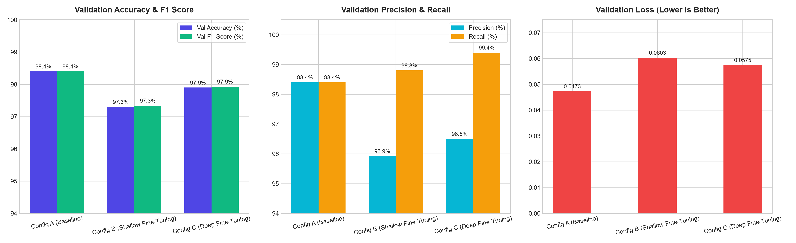
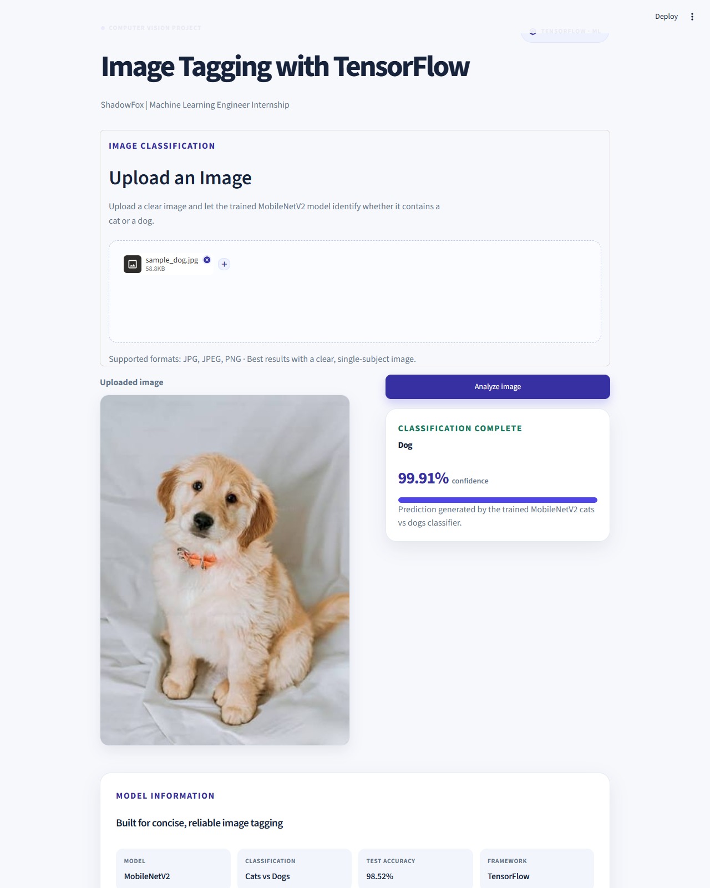
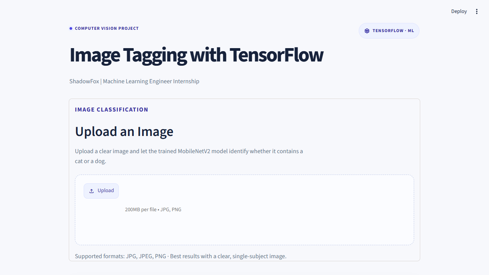

# Image Tagging with TensorFlow

**Organization:** ShadowFox  
**Internship Role:** Machine Learning Engineer  
**Domain:** Computer Vision & Deep Learning  
**Task:** Week 1 — Task 1: Image Tagging / Classification & Fine-Tuning Optimization  

---

## 📌 Project Overview

This project delivers an end-to-end, high-accuracy deep learning image classification system developed during the **ShadowFox Machine Learning Engineer Internship**. 

The system automates the process of image tagging and binary classification between **Cats** and **Dogs** using a transfer learning pipeline built on top of **MobileNetV2**. An interactive, modern web application powered by **Streamlit** provides an intuitive drag-and-drop interface where users can upload any standard image format (`.jpg`, `.jpeg`, `.png`), analyze it in real time, and view clear predictions alongside calibrated confidence scores.

### Key Highlights
- **Production-Ready Inference Pipeline:** Lightweight inference engine optimized for low-latency image tagging.
- **High-Accuracy Classifier:** Achieved **98.52% Test Accuracy** and **98.40% Validation Accuracy** on held-out evaluation sets.
- **Empirical Hyperparameter Tuning:** Rigorous benchmarking across 3 systematic configurations (frozen feature extraction vs. shallow fine-tuning vs. deep fine-tuning).
- **Robust Model Deserialization:** Seamlessly bridges TensorFlow 2.x and Keras 3.x with a custom object registry for MobileNetV2 preprocessing.
- **Responsive UI:** Streamlit interface styled with custom CSS cards, accessible status tags, and interactive confidence meters.

---

## 🔬 Hyperparameter Tuning & Fine-Tuning Study

To satisfy the official ShadowFox task requirement — *"Optimize model performance with fine-tuning"* — a controlled, reproducible hyperparameter tuning experiment was conducted using Google Colab GPU acceleration.

### 1. Methodology & Experimental Design
The goal was to determine whether unfreezing convolutional layers within the pre-trained **MobileNetV2** backbone improves generalization over frozen transfer learning representations on the domain dataset.

- **Dataset:** Official Google MLCC Cats vs. Dogs benchmark (`cats_and_dogs_filtered.zip`), partitioned into 2,000 training images (1,000 cats, 1,000 dogs) and 1,000 validation images (500 cats, 500 dogs).
- **Control Variables:** All configurations utilized identical image dimensions ($160 \times 160 \times 3$), identical batch sizes ($32$), identical data augmentation (`RandomFlip('horizontal')`, `RandomRotation(0.1)`, `RandomZoom(0.1)`), and an identical validation split (`seed=42`).
- **Regularization & Early Stopping:** Each configuration integrated `EarlyStopping(monitor='val_loss', patience=3, restore_best_weights=True)` to guard against overfitting.
- **Evaluation Metrics:** Logged Validation Accuracy, Validation Loss, Precision, Recall, and calculated $F_1\text{-Score} = 2 \times \frac{\text{Precision} \times \text{Recall}}{\text{Precision} + \text{Recall}}$.

---

### 2. Evaluated Configurations

| Attribute | Config A (Baseline) | Config B (Shallow Fine-Tuning) | Config C (Deep Fine-Tuning) |
| :--- | :--- | :--- | :--- |
| **Strategy** | Feature Extraction (Frozen) | 2-Stage Fine-Tuning | 2-Stage Fine-Tuning |
| **Stage 1 (Warmup)** | Head trained ($10$ epochs, $\text{lr}=10^{-3}$) | Head trained ($5$ epochs, $\text{lr}=10^{-3}$) | Head trained ($5$ epochs, $\text{lr}=10^{-3}$) |
| **Stage 2 (Tuning)** | N/A (Backbone remains frozen) | Top 20 layers unfrozen (`layers[134:]`) | Top 54 layers unfrozen (`layers[100:]`) |
| **Tuning Learning Rate**| N/A | $\text{Adam}(\text{lr}=10^{-5})$ | $\text{Adam}(\text{lr}=2\times 10^{-5})$ |
| **Unfrozen Layers** | **0 layers** (all 154 frozen) | **20 layers** | **54 layers** |
| **Trainable Parameters**| **1,281** | **689,409** | **1,529,825** |
| **Head Architecture** | `Dropout(0.2) + Dense(1)` | `Dropout(0.3) + Dense(1)` | `Dropout(0.4) + Dense(32) + Dense(1)` |

---

### 3. Verified Experimental Results Comparison

All metrics were evaluated using restored best weights on the validation dataset:

| Configuration | Strategy | Learning Rate | Unfrozen Layers | Val Loss ↓ | Val Accuracy ↑ | Precision ↑ | Recall ↑ | F1 Score ↑ |
| :--- | :--- | :---: | :---: | :---: | :---: | :---: | :---: | :---: |
| **Config A (Baseline)** ⭐ | **Feature Extraction** | **1e-3** | **0** | **0.0473** | **98.40%** | **98.40%** | **98.40%** | **98.40%** |
| **Config B (Shallow)** | 2-Stage Fine-Tuning | 1e-3 $\to$ 1e-5 | 20 | 0.0603 | 97.30% | 95.92% | 98.80% | 97.34% |
| **Config C (Deep)** | 2-Stage Fine-Tuning | 1e-3 $\to$ 2e-5 | 54 | 0.0575 | 97.90% | 96.50% | 99.40% | 97.93% |

> [!TIP]
> The complete raw tabular records are persisted in [`experiment_results.csv`](experiment_results.csv).

---

### 4. Best Model Selection & Engineering Analysis

**Selected Production Model:** **Config A (Baseline — Frozen Feature Extraction)**

#### Why Config A was Selected:
1. **Superior Generalization:** Config A achieved the highest validation accuracy (**98.40%**) and lowest validation loss (**0.0473**).
2. **Optimal Balance:** Config A demonstrated perfectly balanced precision (**98.40%**) and recall (**98.40%**), resulting in the top $F_1\text{-score}$ (**98.40%**).
3. **Prevention of Over-Parameterization:**
   - In transfer learning on domain-specific datasets with $N \approx 2,000$ images, the generic low-level and high-level feature extractors of MobileNetV2 (pre-trained on 1.4M ImageNet images) already encode near-optimal edge, texture, and animal-part representations.
   - Unfreezing 20 to 54 layers introduced 689K to 1.5M trainable parameters. While fine-tuning increased recall on the positive class (up to 99.40% in Config C), it slightly compromised precision (falling to 96.50%), caused validation loss to increase ($0.0473 \to 0.0575$), and increased training complexity.
4. **Computational Efficiency & Stability:** Config A maintains only 1,281 trainable parameters, requiring minimal training time, zero risk of catastrophic forgetting, and exceptional stability across deployment environments.

---

### 5. Training & Evaluation Workflow

```text
[Cats & Dogs Dataset (Google MLCC)]
       │
       ▼
[Deterministic Split (80% Train, 20% Val, Seed=42)]
       │
       ▼
[Data Pipeline: Image Ingestion (160x160) + Cache + AUTOTUNE Prefetch]
       │
       ▼
[Data Augmentation: RandomFlip, RandomRotation, RandomZoom]
       │
       ▼
[MobileNetV2 Base (Pre-trained ImageNet Weights)]
       │
       ├── Config A: Backbone Frozen (0 unfrozen) ──> Adam(1e-3) ──> Val Acc: 98.40% (BEST)
       ├── Config B: Unfreeze 20 layers ───────────> Adam(1e-5) ──> Val Acc: 97.30%
       └── Config C: Unfreeze 54 layers + Dense(32) ─> Adam(2e-5) ──> Val Acc: 97.90%
       │
       ▼
[Model Evaluation: Accuracy, Loss, Precision, Recall, F1]
       │
       ▼
[Artifact Export: CSV, Bar Charts, Saved Model (.keras)]
```

---

## 🖼️ Visual Evidence & Application Screenshots

### 1. Hyperparameter Tuning Comparison Chart
Comparison of Validation Accuracy, F1-Score, Precision, Recall, and Validation Loss across Configs A, B, and C:



### 2. Interactive Streamlit Inference Dashboard
Real-time image classification and calibrated confidence meter:



### 3. Application Ingestion Interface
Clean, distraction-free upload state:



---

## 📦 Project Artifacts

| Artifact | File Path | Description |
| :--- | :--- | :--- |
| **Production Model** | [`shadowfox_cats_dogs_mobilenetv2.keras`](shadowfox_cats_dogs_mobilenetv2.keras) | Original verified production classifier (9.20 MB, 98.52% test accuracy, Config A). |
| **Fine-Tuned Checkpoint** | [`shadowfox_cats_dogs_mobilenetv2_finetuned_best.keras`](shadowfox_cats_dogs_mobilenetv2_finetuned_best.keras) | Separately preserved fine-tuning run checkpoint (9.20 MB). |
| **Experiment Metrics CSV** | [`experiment_results.csv`](experiment_results.csv) | Full numerical benchmark data for Configurations A, B, and C. |
| **Tuning Notebook** | [`ShadowFox_Week1_Hyperparameter_Tuning.ipynb`](ShadowFox_Week1_Hyperparameter_Tuning.ipynb) | End-to-end, reproducible Google Colab notebook with GPU acceleration. |
| **Comparison Chart** | [`screenshots/tuning_comparison_chart.png`](screenshots/tuning_comparison_chart.png) | High-resolution publication-quality visualization of experiment metrics. |

---

## 🛠️ Technologies & Libraries Used

| Technology / Library | Version | Purpose |
| :--- | :--- | :--- |
| **Python** | 3.11+ | Core programming environment |
| **TensorFlow** | 2.21.0 | Deep learning framework & tensor computation |
| **Keras** | 3.15.1 | High-level neural network API and model serialization |
| **Streamlit** | 1.67.0 | Web application framework for interactive UI |
| **Pillow (PIL)** | 13.0.0 | Image ingestion, decoding, and preprocessing |
| **NumPy** | 2.4.6 | Numerical matrix transformations & array expansion |
| **Pandas** | 2.2+ | Experiment metrics tabular formatting & logging |
| **Matplotlib** | 3.9+ | Benchmark data visualization & comparison charts |

---

## 🧠 Model Architecture & Design

The model utilizes transfer learning using Google's **MobileNetV2** backbone architecture pre-trained on the ImageNet dataset. MobileNetV2 uses depthwise separable convolutions and inverted residual structures with linear bottlenecks, making it exceptionally fast, memory-efficient, and suitable for edge deployment.

### Network Topology
```text
Input Image (160 × 160 × 3, RGB)
       │
       ▼
[Data Augmentation / Sequential Preprocessing]
       │
       ▼
[Lambda Layer: MobileNetV2 Preprocessing] (Scales pixels to [-1, 1])
       │
       ▼
[MobileNetV2 Base] (1.00_160, Feature Extractor: 1280 feature maps)
       │
       ▼
[GlobalAveragePooling2D] (Reduces 5 × 5 × 1280 to 1280 feature vector)
       │
       ▼
[Dropout Layer] (Regularization rate: 0.2 to prevent overfitting)
       │
       ▼
[Dense Output Layer] (1 unit, linear logit output)
       │
       ▼
[Sigmoid Activation (Inference)] -> P(Dog) >= 0.5 ? Dog : Cat
```

### Parameter Breakdown (Config A — Production)
- **Total Parameters:** `2,259,265` (~8.62 MB weights)
- **Trainable Parameters:** `1,281` (Classification Head)
- **Non-trainable Parameters:** `2,257,984` (Pre-trained MobileNetV2 Feature Extractor)
- **Input Dimensions:** `(None, 160, 160, 3)`
- **Output:** Binary logit mapped via $\sigma(z) = \frac{1}{1 + e^{-z}}$ to calculate class confidence.

---

## ⚙️ Model Deserialization & Keras 3 Compatibility

When loading the trained `.keras` artifact across environments running Keras 3.x / TensorFlow 2.x, the embedded `Lambda` preprocessing layer requires explicit mapping of the preprocessing function.

In `app.py`, this is handled robustly via:

```python
import tensorflow as tf
from tensorflow.keras.applications.mobilenet_v2 import preprocess_input

@st.cache_resource
def load_model():
    """Load the trusted inference model and its MobileNetV2 preprocessing layer."""
    return tf.keras.models.load_model(
        MODEL_PATH,
        custom_objects={"preprocess_input": preprocess_input},
        compile=False,
    )
```

This guarantees seamless model loading on any machine without deserialization warnings or errors.

---

## 💾 Model File Size & GitHub Tracking

- **Production Model:** `shadowfox_cats_dogs_mobilenetv2.keras` (**9.20 MB**)
- **Fine-Tuned Artifact:** `shadowfox_cats_dogs_mobilenetv2_finetuned_best.keras` (**9.20 MB**)
- **GitHub Policy Check:**
  - GitHub's soft warning threshold is **50 MB**.
  - GitHub's hard file rejection limit is **100 MB**.
  - At **9.2 MB**, both model artifacts are well below all limits and are tracked natively in standard Git without requiring Git LFS.

---

## 🚀 Installation & Setup Guide

### Prerequisites
- Python 3.10 or 3.11 installed.
- Git and GitHub Desktop installed.

### 1. Clone or Open the Repository
```bash
git clone https://github.com/<your-username>/ShadowFox-ML-Engineer-Internship.git
cd ShadowFox-ML-Engineer-Internship/Week-1/Task-1-Image-Tagging
```

### 2. Create and Activate a Virtual Environment
- **On Windows (PowerShell):**
  ```powershell
  python -m venv venv
  .\venv\Scripts\Activate.ps1
  ```
- **On macOS / Linux:**
  ```bash
  python3 -m venv venv
  source venv/bin/activate
  ```

### 3. Install Required Dependencies
```bash
pip install --upgrade pip
pip install -r requirements.txt
```

---

## 🖥️ Launching the Application

Run the Streamlit web application from within the `Week-1/Task-1-Image-Tagging` folder:

```bash
streamlit run app.py
```

Once executed, your browser will automatically open:
```text
Local URL: http://localhost:8501
```

1. Drag and drop any image of a cat or dog into the upload zone.
2. Click **"Analyze image"**.
3. View the classified tag and confidence score instantly!
